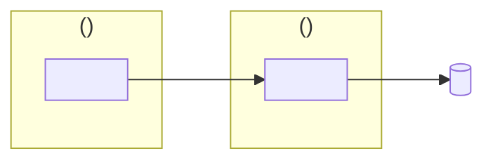
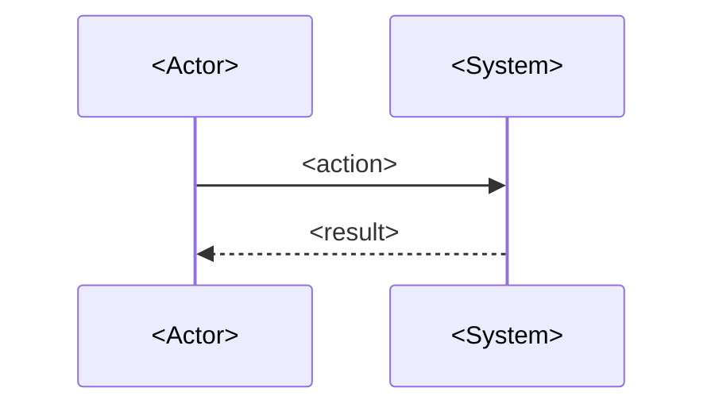

# Comment template

Replace each `<…>` and drop the guidance in parentheses. Keep every heading and its number.

````markdown
## Review without the code: <what the PR does, in a few words>

> **Risk: <low | medium | high>.** <Why, in one sentence.> The main risk: <the risk>, see <section number>.
>
> **Size:** <N> production files, about <N> lines added. The other <N> files are tests. (Or: "<N> data files and <N> constant. No logic.")

### 1. What changes for each actor

**<Actor>** <does what>:

| Situation | Result |
|---|---|
| <situation, with real values> | <what they get> |

Before this PR, <what happened instead>.

### 2. How it works

Where the change lives:



<One sentence on boundaries.>

The flow:



What changed in the flow:

```diff
 <unchanged step>
-<old step>
+<new step>
```

### 3. Side effects

| Effect | Can you undo it? |
|---|---|
| <effect> | <Yes, how> / **No.** <why> |

### 4. Comparison with <ticket key>

| Criterion | PR | Evidence |
|---|---|---|
| <criterion id: short text> | ✅ / ⚠️ / ❌ | <test name or check> |

<Does the PR description agree with the change?>

### 5. Decisions that no source approved

Please answer yes or no to each:

1. **<The choice, in bold.>** <What it means for the actor, and what the sources say or do not say.> <Question?>

### 6. Do the tests prove it?

| Scenario | Test |
|---|---|
| <scenario> | ✅ <where> / ❌ <the gap> |

### 7. If it breaks in production, who finds out?

| Failure | Signal |
|---|---|
| <failure> | <alert / metric / log / the user sees an error / nothing> |

<details>
<summary>Sources</summary>

- Ticket: <key and the tables or criteria used>.
- Tests: <files and the contexts used>.
- Code: <files read at the PR head, and why>.
- CI: <workflows that run on merge>.
</details>
````
